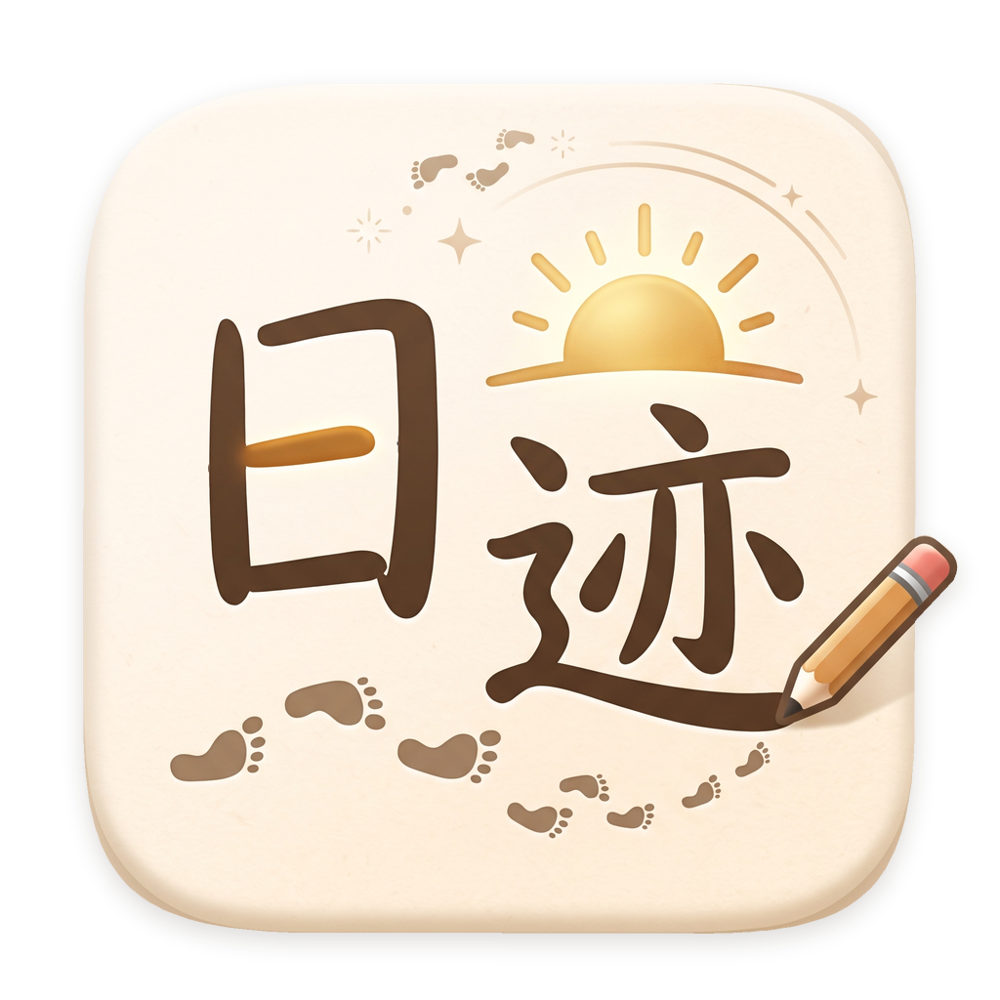
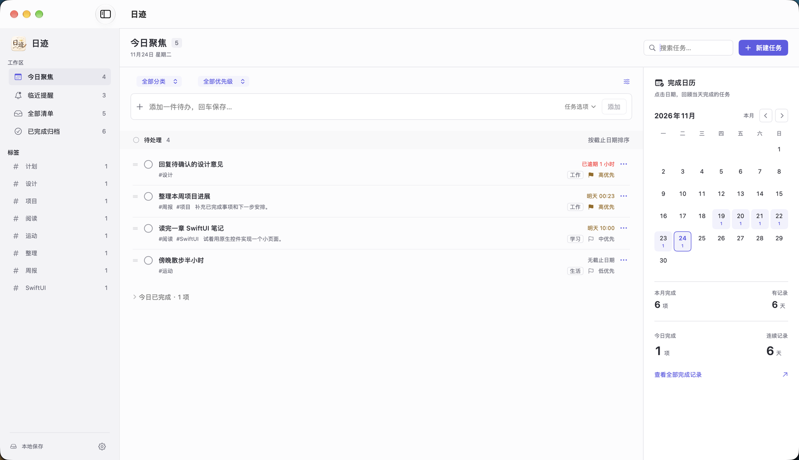
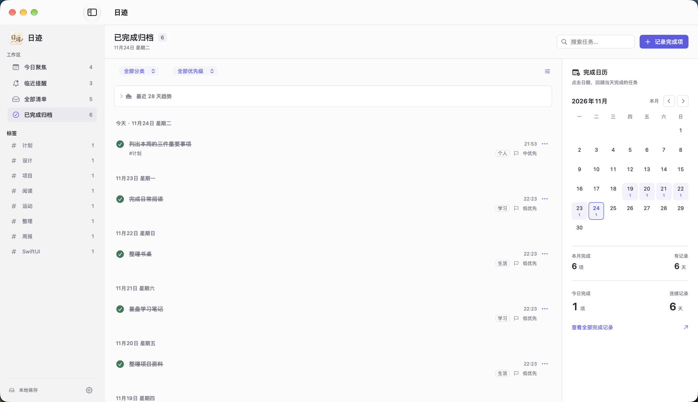
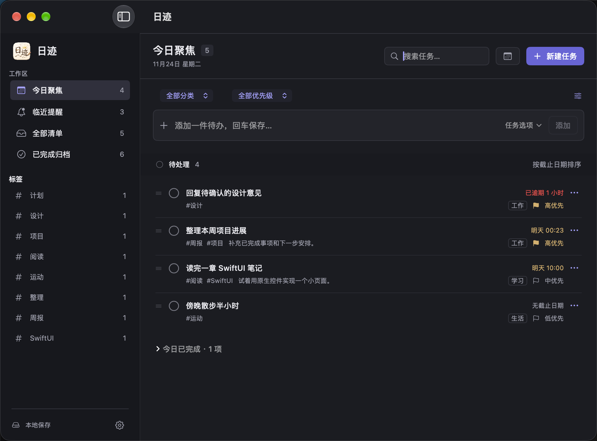

<p align="center">
  
</p>

<h1 align="center">Flowday</h1>

<p align="center">原生 macOS 待办清单，记录任务与每天的完成。</p>

<p align="center">SwiftUI · macOS 14+ · WidgetKit · 本地存储</p>

Flowday 将任务清单、截止提醒和完成日历放在同一个工作台中。你可以快速记录待办，按分类、优先级与标签整理任务，也可以从日历回顾某一天完成的事情。

应用无需注册账号，任务与设置保存在本机，支持离线使用和 JSON 备份。



<details>
<summary>查看完成归档与深色外观</summary>

**完成归档**



**深色外观与窄窗口**



</details>

*界面截图使用更名前的示例任务界面；应用首次启动为空清单。*

## 功能

| 功能 | 说明 |
| --- | --- |
| 任务工作台 | 今日聚焦、临近提醒、全部清单、已完成归档；宽窗口常驻完成日历，窄窗口通过按钮打开日历。 |
| 快速记录 | 快速添加、新建与编辑任务，也可直接记录已完成事项；支持完成、恢复和删除确认。 |
| 分类与筛选 | 工作、个人、学习、生活四种分类，高／中／低优先级，自定义标签和全文搜索，可组合筛选。 |
| 排序与调整 | 按截止日期、优先级或创建时间排序，支持拖动与菜单调整任务顺序。 |
| 完成日历 | 按实际完成日期统计，支持切换月份、回到本月和按天查看，附带近 28 天完成趋势与连续记录。 |
| 本地提醒 | 设置截止日期与时间，选择提前提醒范围，支持延后 1 小时提醒。 |
| 桌面小组件 | 今日待办、每日任务、完成日历三种 WidgetKit 组件。 |
| 外观与备份 | 跟随系统、浅色与深色外观；导入、导出 JSON 备份，兼容旧版任务数据。 |

## 从源码运行

### 环境

- macOS 14 或更新版本。
- 完整的 Xcode，项目已在 Xcode 27.2 中构建验证。
- 用于开发签名的 Apple ID 和开发团队；本机已使用免费的 Personal Team 验证主应用与组件。

工程使用 SwiftUI、Observation、WidgetKit 和 UserNotifications，无第三方包依赖。

### 配置签名

1. 下载或克隆源码，打开 [`Flowday.xcodeproj`](Flowday.xcodeproj)。
2. 在 **Xcode → Settings → Apple Accounts** 中登录自己的 Apple ID。
3. 将工程和 **Flowday、FlowdayWidgets** 两个 Target 的 **Development Team** 改为自己的团队，启用 **Automatically manage signing**，检查 Debug 与 Release 两种配置。测试 Target 也需要使用同一团队。
4. 如 Bundle Identifier 发生冲突，为主应用与扩展设置各自唯一的标识符。
5. 检查工程的 `DAYLIGHT_APP_GROUP` 设置。默认值为 `$(DEVELOPMENT_TEAM).local.daylight.native`，主应用与扩展必须使用相同的值；两者的 entitlement 和 Info.plist 已通过此设置关联。

当前工程包含 App Groups 共享数据能力，需要有效的开发签名。用于本机开发的签名与面向其他用户发布应用时使用的签名、公证配置不同。

### 启动应用

在 Xcode 中选择 **Flowday** Scheme 和 **My Mac**，按 `⌘R` 运行。

完成签名配置后，也可在工程根目录执行：

```sh
./Scripts/build.sh
```

Release 产物位于：

```text
.build/Build/Products/Release/Flowday.app
```

脚本默认使用 `/Applications/Xcode.app`。Xcode 安装在其他位置时，可通过 `DEVELOPER_DIR` 指定其 `Contents/Developer` 目录。

## 桌面小组件

| 组件 | 尺寸 | 内容与入口 |
| --- | --- | --- |
| 今日待办 | 小、中 | 今日待办数量、任务标题和今日完成数；点击打开今日聚焦。 |
| 每日任务 | 大 | 完成进度环、待办与完成数量、最多 4 条任务详情，优先展示待办；提供新建任务和查看全部入口。 |
| 完成日历 | 中、大 | 本月完成日历、完成数量与连续记录；点击打开完成归档。 |

添加方式：

1. 启动 Flowday，打开设置，确认 **桌面小组件 → 任务同步** 显示“已同步”。
2. 右键点击 macOS 桌面空白处，选择 **编辑小组件**。
3. 搜索 **Flowday**，选择组件类型和尺寸，添加到桌面。

组件展示主应用同步的任务快照；点击“记录新任务”或加号会打开应用的新建窗口。文字输入、勾选任务和完整列表浏览在应用内完成，组件不支持直接输入或滚动列表。

应用保存任务后会请求刷新组件，退出应用后组件仍可读取最近的快照。实际刷新时机由 macOS 调度；若内容尚未更新，可打开应用并在设置中点击“重新同步小组件”。请保留承载组件的 `Flowday.app`。

## 数据与备份

为兼容更名前的版本，数据路径与组件共享标识继续沿用原值。任务与设置保存在：

```text
~/Library/Application Support/DaylightNative/tasks.json
```

- **导出：** 在设置中选择“导出备份…”，保存包含任务与设置的 JSON 文件。
- **导入：** 支持 Flowday 备份和旧版任务数组，以任务标识合并；重复标识保留已有任务，导入不覆盖当前设置。
- **完整恢复：** 退出应用后，将完整备份恢复至上述数据文件位置，再重新启动应用。
- **异常保护：** 保存采用原子替换；读取失败时保留原文件并暂停写入。

组件共享快照单独保存在 `~/Library/Group Containers/<TeamID>.local.daylight.native/widget-snapshot.json`，不改变原始任务文件的位置。若自定义 App Group，快照目录随之变化。

## 快捷键

| 快捷键 | 操作 |
| --- | --- |
| `⌘N` | 新建任务，在完成归档中直接记录完成项 |
| `⇧⌘N` | 记录今日完成项 |
| `⌘K` | 聚焦搜索 |
| `⌘1` / `⌘2` / `⌘3` / `⌘4` | 切换今日聚焦、临近提醒、全部清单、完成归档 |
| `⌘,` | 打开设置 |
| `⇧⌘E` | 导出备份 |
| `⌘↩` | 在编辑窗口保存 |
| `Esc` | 取消编辑 |

## 开发与测试

```sh
# 核心测试，不操作界面
./Scripts/test.sh -only-testing:FlowdayTests

# 核心测试与 UI 流程
./Scripts/test.sh

# 从图标源文件重新生成 ICNS
./Scripts/build-icon.sh
```

测试覆盖任务生命周期与持久化、筛选和排序、日期边界、完成日历、提醒计划、组件快照及链接导航。测试使用独立的临时数据目录；UI 测试会操作前台窗口，禁用通知并避免将示例数据同步到真实桌面组件。

## 使用说明
- 系统通知需要在应用设置中授权；展示受系统权限、专注模式及系统调度影响。应用每次同步最多安排最早的 64 条通知请求，任务修改或下次启动时继续更新。
- 最低部署目标为 macOS 14；已在 Apple Silicon 上验证构建与运行，Intel Mac 和 macOS 14 尚未实机验证。